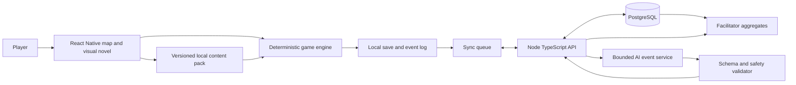

# Pocket Town Architecture

## Goal and boundaries

The app is a React Native and Expo game with a pixelated 2.5D map, a branching visual novel renderer, and a deterministic financial simulation. The town uses a rectangular logical ground grid with an angled overhead view, visible building fronts and roofs, layered pixel sprites, shadows, and depth sorting. The visual direction is defined in [design.md](design.md). It must work without connectivity. A Node.js and TypeScript service adds pseudonymous cloud save, content distribution, facilitator aggregates, and optional AI event personalization. The client must never depend on the AI service to finish a level.

The engine computes all money, gates, weight changes, and replay results. The AI service may only choose an approved event variant and bounded narrative parameters. See [game_rules.md](game_rules.md) and [ai_event_engine.md](ai_event_engine.md).

## System diagram



## Recommended repository layout

```text
apps/
  mobile/                 Expo app, map UI, visual novel UI, local persistence
  api/                    Node.js/TypeScript API and optional AI adapter
  facilitator/            Minimal web dashboard or API-backed classroom view
packages/
  engine/                 Pure TypeScript ledger, rules, gates, replay, tests
  content-schema/         JSON Schema, types, content validator
  content/                Seven maps, translations, authored fallback events
  shared/                 API contracts and stable IDs
```

## Client modules

| Module | Responsibility |
| --- | --- |
| Map renderer | Project logical map coordinates into the angled overhead view; draw ground, buildings, sprites and foreground layers with correct depth; manage camera, hit areas, walkable routes and repair pins. Navigation never changes money by itself. |
| Visual novel renderer | Open a full chapter on every building selection: illustrated background, character portraits and expressions, speaker dialogue, branching choices, financial objects/overlays, consequence beats, reflection and replay. Resolve follow-up chapters from saved story state and content JSON. |
| Game engine | Apply choices, maintain integer-paise ledger, advance fictional time, calculate interest and asset scenarios, update weights, evaluate gates, and recompute branches. It is a pure function over versioned state and choice data. |
| Content loader | Validate signed/versioned content packs, resolve localization keys, and keep the active save bound to a compatible content version. |
| Local store | Persist the current snapshot, append-only decision log, language, accessibility options, and pending sync work. Expo SQLite is a reasonable starting adapter. |
| Sync worker | Upload pseudonymous event batches when online, retry idempotently, and never block offline play. |

## 2.5D map rendering and navigation

Keep simulation and map navigation coordinates separate from screen pixels. The supplied references establish an angled overhead view with straight streets and a rectangular ground grid. For logical ground coordinates `(u, v)`, tile footprint dimensions `(groundTileWidth, groundTileDepth)`, and any authored visual elevation offset, start with:

```text
screenX = u * groundTileWidth
screenY = v * groundTileDepth - authoredElevationOffset
```

Camera offset and scale transform these projected positions for display. The initial maps use a single walkable ground plane; visual building height comes from pixel sprite artwork. A future elevated route needs explicit height and navigation metadata before it can affect movement. Use `projection: "angled_overhead"` and the visual rules in [design.md](design.md).

- **Draw order:** ground tiles and shadows first; buildings, props, and characters next, sorted by their ground contact or foot position; authored foreground pieces next; labels, entrance markers, and repair pins above the scene. Split large buildings into base and foreground/roof layers where one depth key would hide a character incorrectly.
- **Anchors:** every sprite has a ground anchor, visual bounds, and asset ID. Buildings also have a collision footprint, entrance node, and tap polygon. The tap polygon follows the usable building area rather than only its rectangular texture bounds.
- **Movement:** a walkable grid or navigation graph defines legal routes. Convert a ground tap through the inverse projection, find a reachable node, and route the avatar around building footprints. A building tap resolves to its entrance and scene ID. The scene can open immediately with an optional short transition so movement does not delay learning.
- **Occlusion:** fade or hide authored foreground pieces when needed, and draw an avatar outline or marker when behind a building. Hit testing uses visible interactive layers in depth order; it must not open a building behind the intended target.
- **Camera:** use a fixed angled overhead view, bounded pan, optional discrete zoom steps, and an initial framing that exposes the starting home and next relevant building. Preserve pixel edges with nearest-neighbor sampling and keep text at native interface size. Persist the camera locally for resume; it is not part of financial state.
- **Performance:** use sprite atlases where appropriate, cull offscreen tiles and props, avoid rerendering the entire map on every avatar frame, and load assets by level. Verify the renderer with representative scene density on the target Android device before selecting the final drawing library.

The map renderer consumes versioned geometry and asset metadata from [content_authoring.md](content_authoring.md). It emits navigation and building-selection actions to the UI; only a confirmed scene choice can invoke a money transaction. Building selection transitions from the town view to a dedicated visual novel chapter screen. Its chapter runner resolves the current background, characters, dialogue beat, choices, and scene objects; the renderer presents a readable interface over the illustrated location. Story progression and financial calculations stay in their respective state and engine layers. See [visual_novel_design.md](visual_novel_design.md).

## Server modules

- **API:** authentication through a random learner ID and class code, save backup, content manifest, event request, and facilitator aggregate endpoints. No real bank login or financial account connection exists.
- **PostgreSQL:** durable learner progress and versioned decisions. A Firebase adapter is possible later, but use one backing store for the first implementation.
- **AI adapter:** receives a small, pseudonymous state summary and a rule-selected event envelope. It returns structured event text/variant IDs, never a changed balance or gate. The API validates it and uses an authored fallback when unavailable.
- **Facilitator view:** shows map completion, concept transfer, bottleneck resolution, language and offline completion counts. It does not expose individual financial choices to peers.

## Choice transaction

1. The renderer passes a stable `sceneId`, `choiceId`, content version, and current snapshot ID to the engine.
2. The engine validates prerequisites and applies an atomic ledger transaction and any fictional time advance.
3. It derives weight evidence, concept exposure, the next scene, and any gate result. In one local transaction, write the immutable decision event, resulting snapshot, and branch-scoped presentation resume record at the post-choice consequence beat. Repeated taps and interrupted sessions must not apply that choice again.
4. The UI renders a consequence card with the exact numerical change and a plain-language explanation.
5. If the event selector finds an eligible bottleneck, the client first loads an authored local variant. When online, the server may return a validated personalized variant for the same event envelope.

The client rejects duplicate choice IDs against the same snapshot. Server sync is idempotent using a device-generated event ID. Replaying an earlier choice creates a new branch from the earlier snapshot and recomputes all downstream numbers; it never grants rewards twice.

Activate a repair branch and its recomputed snapshot/return beat atomically. Resume records must match the active branch, snapshot, and pinned content version; stale records from a comparison branch cannot control the visible chapter. See `PresentationResume` in [data_model.md](data_model.md).

## Interfaces and deployment decisions

- Use TypeScript types generated from JSON Schema for scenes, choices, save snapshots, and event proposals.
- Pin a content pack version to a playthrough. Migrate saves only through an explicit, tested migration; do not silently reinterpret old decisions.
- Store currency as integer paise and fictional time as explicit ticks or dates. Display rupees only at the UI boundary.
- Keep all reference rates and prices in versioned content, labelled illustrative. The engine applies formulas but does not fetch market prices or current tax rules.
- The API and AI adapter are optional for play. The mobile app bundles complete authored scenes, fallback bottlenecks, and the deterministic engine.
- Keep secrets server-side. No provider key or model prompt belongs in the mobile bundle.

## Failure behavior

| Failure | Behavior |
| --- | --- |
| No network | Complete all seven levels using bundled content and local saves; queue anonymous sync. |
| AI timeout or invalid response | Use the rule-selected authored event for the same demerit and severity. |
| Interrupted save | Recover the last committed snapshot and replay the pending choice once. |
| Content version mismatch | Continue on the pinned pack or run an explicit migration; never mix rules from two versions. |
| Cloud conflict across devices | Preserve both branches, choose a clear active branch with the learner, and never merge two ledgers arithmetically. |

## Design review gates

The vertical slice must prove offline play, deterministic replay, a later bottleneck from earlier evidence, and exact return to the source choice. Full release additionally requires the seven-map content pack, translations, facilitator aggregates, and the test gates in [quality_and_learning.md](quality_and_learning.md).
