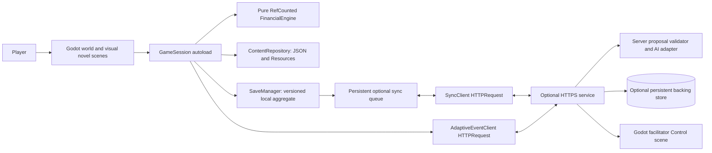

# Pocket Town Architecture

## Target and implementation status

Pocket Town will be a Godot 4.x stable project using the standard GDScript build and Compatibility renderer. This document specifies the migration target; it does not claim that the Godot game is already implemented. Pin the selected stable editor and export templates together before development.

The game uses a **2D scene tree to create the pixelated 2.5D look**: an angled overhead rectangular ground plane, visible roof and building fronts, layered sprites, shadows, and sorting by the ground contact point. The experience switches to a dedicated visual novel inside every building. Financial learning, English readability, offline play and safe retry remain central. See [design.md](design.md), [visual_novel_design.md](visual_novel_design.md) and [game_rules.md](game_rules.md).

## System diagram



All seven maps, complete English chapters, deterministic rules and authored adaptive events are bundled. Network services are optional and never prevent a level from finishing.

## Canonical repository layout

```text
game/
  project.godot
  scenes/
    main/                   Bootstrap and shell
    world/                  Level maps, terrain and Camera2D
    player/                 CharacterBody2D player
    buildings/              Entrances and interaction areas
    visual_novel/            Chapter stage and financial object views
    ui/                     HUD, journal, settings and facilitator Control scene
  scripts/
    autoload/               GameSession, SaveManager, ContentRepository,
                            SceneRouter, AudioManager
    engine/                 Pure RefCounted financial rules and event selection
    content/                JSON/Resource validation and text lookup
    world/                  Movement, interaction and depth ordering
    visual_novel/            Beat runner, branch presentation and focus
    ui/                     Control scripts and accessible input
    network/                Optional SyncClient and AdaptiveEventClient
  resources/                Typed Resource definitions and reusable settings
  content/                  Versioned English maps, chapters and event packs
  assets/                   Original pixel art, fonts, audio and atlases
  tests/                    Headless GDScript fixtures and scene integration tests
contracts/
  content/                  JSON Schemas and golden content fixtures
  saves/                    Aggregate schema, migrations and replay fixtures
  api/                      HTTPS request/response schemas and examples
services/                   Optional server; implementation language is not fixed
```

## Runtime modules and ownership

| Component | Responsibility |
| --- | --- |
| `GameSession` autoload | Own the active playthrough, invoke engine operations, coordinate a validated choice commit, emit state changes and expose immutable presentation data. |
| `FinancialEngine extends RefCounted` | Compute ledger, paise balances, fictional time, interest, weights, gates and replay from supplied state/content. No scene tree, input, network, filesystem, wall clock or frame-rate dependency. |
| `ContentRepository` autoload | Load JSON and typed Resources, validate schemas/IDs and bounds, resolve English text keys, and pin a compatible content version. Never execute content as script. |
| `SaveManager` autoload | Write one versioned save aggregate using `FileAccess` under `user://`; validate temporary and backup generations before activating a save. |
| `SceneRouter` autoload | Switch map/chapter scenes, pass stable IDs, preserve return points, and release old scene signal connections and input focus. |
| `AudioManager` autoload | Manage buses, volume, captions and optional English narration independently of financial state. |
| World scenes | Present map geometry, movement, collisions, entrance prompts, repair pins and camera. Movement alone cannot earn or spend money. |
| Visual novel scenes | Run authored beats and branching choices; show background, expressive characters, receipts, consequences, reflection and replay. Submit each confirmed choice through `GameSession`. |
| `SyncClient` / `AdaptiveEventClient` | Optional HTTPS `HTTPRequest` adapters with application deadlines, cancellation, schema validation and authored fallback. No provider secret is stored in the game. |
| Facilitator `Control` scene | Show minimal class progress aggregates with an authorized facilitator session; shared-device local progress remains available offline. |

## Map rendering, movement and controls

Use `TileMapLayer` terrain, `Sprite2D`/`AnimatedSprite2D` artwork, `Node2D` scene composition, `Camera2D`, and authored collision footprints. Pixel art uses nearest filtering and integer-aligned pixel presentation where practical. Keep UI text at a readable interface scale. Ground coordinate `(u, v)` maps to an angled overhead image using authored tile width/depth and visual elevation offsets; artwork supplies apparent height.

Enable `y_sort_enabled` on appropriate world containers. Set sprite origins at foot/ground anchors, split roofs or foreground pieces where needed, and use deliberate z layers for terrain, shadows, actors, foreground and entrance indicators. Test occlusion rather than relying on a single sort value for an entire tall building.

The avatar is `CharacterBody2D`; `_physics_process(delta)` reads `Input.get_vector("move_left", "move_right", "move_up", "move_down")`, applies speed and calls `move_and_slide()`. Collision and scene navigation use world coordinates. An `Area2D` entrance identifies the nearest reachable building and exposes its chapter ID. Interactive objects cannot activate through blocked walls.

| InputMap action | Desktop binding | Mobile equivalent |
| --- | --- | --- |
| `move_up/down/left/right` | WASD and arrow keys | Directional `TouchScreenButton` controls invoking the same actions |
| `interact` | E | Interact button at a nearby entrance |
| `dialogue_next` | Enter or Space | Continue button/tap |
| `choice_1` through available choice actions | Number keys | Focusable choice buttons |
| `back` | Escape | Back/close button |
| `journal` | J | Journal button |

Building activation always opens the full visual novel chapter, with mouse/touch selection also supported. Keyboard focus transfers into the chapter's `Control` UI; world movement is suspended while dialogue, a choice, a receipt or a modal is active. Connect signals on entry and disconnect/release on exit. Do not let one Enter press both select a choice and skip its consequence. Number keys only choose currently visible valid choices. Closing returns to the correct map entrance and active branch checkpoint.

Physics ticks animate movement; **fictional financial time advances only through validated authored decisions**. Leaving the app open cannot accrue interest.

## Financial arithmetic and contracts

GDScript `int` provides signed 64-bit arithmetic. Use integer paise, bounded integer basis-point rates and explicit fictional days/ticks. Validate multiplication operands before multiplying; use deterministic integer division with an explicit rounding policy. Never pass financial calculations through float interpolation or pixel coordinates. Display rupees only in UI formatting.

JSON may decode numbers as floating-point values. Validate integral representation, non-negative balances, application maxima, and the JSON exact-integer range before converting to `int`; then restore typed model objects. Use a tighter content/account bound and overflow-safe arithmetic so rate/time multiplication also fits int64. JSON Schemas and GDScript validators define the same rules; headless golden fixtures establish server/client conformance without relying on a particular server language.

## Choice, save and repair commit

1. A chapter submits stable scene/choice IDs, pinned content version and expected snapshot/branch IDs to `GameSession`.
2. The pure engine validates prerequisites, ownership and available resources, then produces a complete candidate decision log, ledger, snapshot, gate and post-choice presentation beat.
3. Validate the entire candidate. Repeated confirmation against the same snapshot is idempotent. A failed replay leaves the active save untouched.
4. Serialize **one aggregate** containing active branch, events, snapshots, pending sync items and branch-scoped resume state. Save to a temporary file, flush/close, reread and verify schema/hash/generation, preserve the prior valid backup, and activate the candidate.
5. Update visible session state only after successful persistence; emit the committed result and show exact financial changes and the explanatory consequence.

The aggregate includes a commit manifest with schema/content versions, generation, active branch and checksum. Recovery examines current, temporary and backup candidates and chooses a fully valid compatible generation. An optional last-good pointer is recovery metadata, not independent financial truth. Test interruptions at each filesystem step on native and web exports. This is an application-level temp/backup protocol, not a database transaction or an unconditional power-loss guarantee; retain a known valid backup and report recoverable failures clearly.

Repair forks from the exact source checkpoint, replaces the old decision evidence and recomputes downstream effects with the same seed. Archive the previous branch for comparison. Activate the new branch, snapshot and return beat in the same aggregate; stale resume records cannot reopen an old branch or grant a reward again.

## Optional service boundary

Contracted services provide pseudonymous class joining, cloud backup, content manifests, facilitator aggregates and bounded event personalization. The server language is an implementation choice. A PostgreSQL backing store is optional. The service must validate/recompute event sequences using the same rules and golden fixtures; never accept submitted balances as authoritative.

`HTTPRequest` clients use HTTPS, application timeouts, bounded payloads, request IDs, and `request_completed` handling. Cancel requests when their target branch/scene becomes obsolete. Browser exports require the service to support the deployed origin's CORS policy. Offline play and authored events remain the default fallback. Provider keys, service administrative credentials and model execution stay server-side.

## Failure and verification gates

| Failure | Behavior |
| --- | --- |
| No network or service deadline | Continue all chapters locally; queue eligible sync and use authored adaptive events. |
| Interrupted or invalid save | Restore a validated compatible aggregate/backup; do not apply a committed choice twice. |
| Content mismatch | Continue the pinned pack or use an explicit tested migration. |
| Cross-device conflict | Preserve separate branches and choose the active playthrough; never add ledgers together. |
| Invalid or stale AI proposal | Discard it and display the approved event matching the current rule envelope. |

Every phase in [phases.md](phases.md) ends with an actual integrated Godot preview and evidence: native desktop keyboard play, web export where available, and device/touch checks when available. Exercise map → building → visual novel → consequences → gate, with regression of completed levels and applicable replay/offline/resume checks. Phase 0 establishes the runnable foundation; Phases 1–7 add complete levels. Record the commit, Godot/export version, target, screenshots or recording, results and unresolved issues before declaring a phase complete. A plan or editor screenshot alone is not a playable preview.
