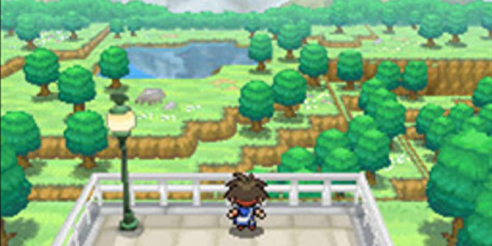
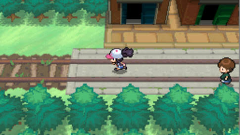
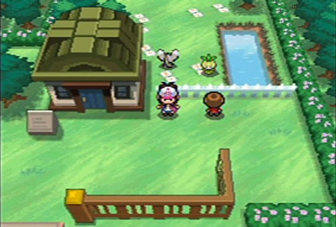
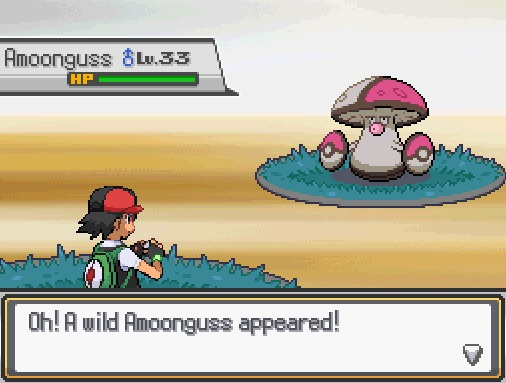

# Pocket Town Design Specification

Pocket Town is a financial learning game with a pixelated 2.5D neighborhood and a visual novel inside every building. The town invites exploration; the building chapters carry the story, money decisions, consequences, and reflection. This file defines the visual direction and interaction design for both modes, using the four supplied images as inspiration.

This is the visual design authority for the project. [comprehensive_overview.md](comprehensive_overview.md) owns the story and curriculum, [game_rules.md](game_rules.md) owns money and progression, and [visual_novel_design.md](visual_novel_design.md) owns chapter structure. Screens and assets should satisfy all three contracts.

Implementation uses Godot 4.x standard GDScript and the Compatibility renderer. The elevated appearance is layered 2D artwork; the game uses no 3D movement or 3D camera. Project scenes, scripts, content, resources, assets, and tests live under `game/`.

## 1. Reference interpretation

The user likes the pixelated 2.5D look of Pokémon Black and White. The design direction comes from the supplied screenshots; the following observations describe their visible composition rather than the original game's implementation.

| Reference | Visible qualities | Pocket Town application |
| --- | --- | --- |
| [01 Overworld depth](design_references/01_overworld_depth.png) | An elevated viewpoint, tree overlap, raised ground, ground shadows, and a small character within a layered environment. | Use visible building fronts and roofs, layered greenery, foreground overlap, and grounded sprites to create depth. |
| [02 Street and sprites](design_references/02_street_and_sprites.png) | Straight street alignment, compact sprites, repeated paving, greenery framing the walkable route. | Keep streets and entrances easy to read; use consistent tile scale and small walking characters. |
| [03 Neighborhood layout](design_references/03_neighborhood_layout.png) | A recognizable roof and façade, open ground around characters, fences, water, and planted borders. | Give each learning building a distinct silhouette and a clear approach, with uncluttered space around its entrance. |
| [04 Dialogue stage](design_references/04_dialogue_stage.png) | Characters staged at different depths, a large bottom dialogue panel, framed information panels, and strong scene focus. | Inside a building, stage the player and NPC against an interior background, keep the bottom dialogue panel prominent, and present receipts or money information as relevant scene objects. |

The fourth reference guides the visual novel's composition. Pocket Town fills that composition with people, interiors, conversations, financial objects, and story choices. Produce original characters, buildings, icons, and UI artwork with a consistent Pocket Town identity.









## 2. Experience priorities

1. **Learning through dialogue and decisions:** Every building opens a complete visual novel chapter. Financial concepts are explained through a problem, a choice, a visible result, and a later transfer.
2. **A town worth exploring:** Distinct buildings, small character animations, greenery, and familiar neighborhood details make the next visit appealing.
3. **Money that can be understood:** A learner can tell what changed, where the money came from, which funds are accessible, and why a later problem relates to an earlier decision.
4. **A safe retry:** Repair scenes feel like returning to a familiar conversation and improving a plan. Feedback remains constructive.
5. **Readable on a phone:** Pixel artwork provides the world and atmosphere. English dialogue, amounts, and touch controls stay readable at native interface size.

Exploration should be brief between chapters. Avoid long travel, precision movement, timed dialogue, or repeated animations that interrupt access to learning. A level's money goal and financial ladder remain the gameplay objectives described in [game_rules.md](game_rules.md).

## 3. Two visual modes

| Mode | Composition | Main action |
| --- | --- | --- |
| Neighborhood exploration | Angled overhead pixel town, visible roofs and façades, small walking avatar, minimal HUD. | Tap a building or explore a street. |
| Building visual novel | Pixel interior/location stage, larger character sprites, dialogue box, branching choices, inspectable financial objects. | Read, investigate, decide, see consequences, reflect, replay. |

Use an entrance fade or short doorway animation to connect the modes. Preserve a consistent palette, character design, and location details across the exterior and interior. A bank with blue-green signage outside should use the same visual accents inside. The player returns to the town at that building's entrance after the chapter.

## 4. Overworld perspective and depth

### Camera and ground plane

Use a fixed angled overhead view with a rectangular logical ground grid. Streets can run horizontally and vertically in screen space, as in the supplied neighborhood references. Building fronts and roofs are painted with a consistent elevated perspective.

The first implementation creates the 2.5D appearance using layered pixel sprites and pre-authored perspective. No perspective rotation is required. A change in camera angle would require matching asset variants and a separate rendering decision.

Each level is a `Node2D` scene. Use `TileMapLayer` for ground and decorative tiles, and a dedicated `Node2D` with `y_sort_enabled = true` for buildings, trees, NPCs, and the player. Place sprite origins at ground-contact feet. Building façade, roof canopy, and foreground fragments may use separate nodes so their overlap remains intentional. Footprint collision belongs to the building base, not its painted roof. Labels and pins use a separate presentation layer above world artwork; the HUD and modal screens belong to a `CanvasLayer`.

Starting projection for a flat logical map:

```text
screenX = u * groundTileWidth
screenY = v * groundTileDepth - authoredElevationOffset
```

Apply the camera position and display scale afterward. `u` and `v` are logical grid coordinates. A decorative raised planter or staircase may use a visual elevation offset. Walkable elevation must have explicit navigation metadata; painted height alone never changes the avatar's route.

### Layer order

1. Ground tiles: road, paving, grass, soil, water edges.
2. Ground details and pixel shadows.
3. Building bases, props, NPCs, and player, sorted by ground-contact position.
4. Authored foreground pieces such as a canopy, tree crown, fence rail, or roof edge.
5. Entrance markers, building names, goal indicators, and repair pins.
6. Screen-space HUD and accessibility controls.

Large structures may need several layers rather than one sprite. For example, a shop façade belongs behind the avatar at the entrance, while an awning may overlap the avatar's head. Every placed asset has a ground anchor and explicit bounds. Use an avatar outline or an authored foreground fade if overlap makes the player hard to locate.

### Grounded characters

Characters share the environment's perspective and sit on a small pixel shadow at their feet. All directions use consistent height, proportions, and animation timing. An avatar facing north shows the back of its head and shoulders; side frames clearly indicate travel direction. NPCs can idle or turn toward the player without a constant animation that distracts from a building marker.

### Camera behavior

Start each level with home or its equivalent starting location visible and a clear route to the first story lead. Follow the avatar gently within map bounds. Permit bounded pan; provide a recenter control after manual pan. The standard view uses a fixed pixel scale. If zoom is offered, use discrete scale steps and preserve pixel edges. Dialogue screens do not inherit overworld pan or zoom.

Implement world follow with `Camera2D` and explicit map limits. Establish a 480 × 320 logical world-art viewport, displayed at integer nearest-filtered scales, with 960 × 640 as the initial desktop window. Use a world `SubViewport` when necessary to isolate pixel scaling from the readable `Control` UI. Letterbox unused space at strict integer scales. Fractional fill scaling is an optional device tradeoff: it can produce uneven pixel widths even with nearest filtering, so compare it against integer letterboxing on target phones. Reflow UI in its own canvas at window resolution; never shrink dialogue text into the low-resolution world viewport. Portrait shortens the world/stage area and reserves readable space for controls.

### Playable movement and interactions

The player is a `CharacterBody2D` with an `AnimatedSprite2D`, a small foot-level `CollisionShape2D`, and four directional idle/walk animations. Map `move_up`, `move_down`, `move_left`, and `move_right` to W/A/S/D and arrow keys in `InputMap`. Read a normalized directional vector in `_physics_process`, set `velocity`, and call `move_and_slide()`; diagonal movement must not be faster. Retain the last nonzero facing direction when standing. Godot's [2D movement guide](https://docs.godotengine.org/en/stable/tutorials/2d/2d_movement.html) provides the engine pattern.

Entrances use `Area2D` proximity zones. E opens the eligible nearby building chapter; a visible prompt names that building. Static footprint collisions keep the avatar outside walls while leaving every entrance reachable. Building taps/clicks and the building list offer the same chapter without demanding precise walking. Optional ground-tap routing requires a tested walkable navigation route around footprints; it must not teleport through buildings.

Enter/Space confirms dialogue, number keys 1/2/3 choose visible options, Escape closes a dismissible overlay or pauses, and J opens the journal. `TouchScreenButton` directional controls or responsive `Control` buttons reuse the same actions on phones. Visual novel mode disables world movement, clears held movement actions and velocity, and gives focus to its active controls. Release actions on lost focus, modal entry, and scene switches; a held key must never move the player behind a chapter. Leaving a modal must not replay the input that opened it.

## 5. Pixel art production rules

These dimensions are initial asset targets to validate in the first playable scene. They are design choices for Pocket Town, not measurements of the reference game.

| Asset | Starting logical dimensions | Notes |
| --- | --- | --- |
| Ground tile | 32 × 24 pixels | Rectangular footprint under the angled overhead view; edges must tile cleanly. |
| Walking character frame | 32 × 48 pixels | Common foot anchor; four directions with idle and walk frames. |
| Tree or tall prop | Multiples of the ground tile with authored vertical extension | Base footprint and crown/foreground layer can differ. |
| Building | Footprint in whole grid cells; texture height varies | Paint façade and roof perspective consistently; keep entrance metadata separate. |
| Interior character sprite | Approximately 64 × 96 pixels | Dedicated close scene art can show expressions and gestures more clearly than a walking sprite. |
| Optional dialogue portrait | Approximately 96 × 128 pixels | A supporting portrait when the stage character would otherwise be too small. |
| Interior background | 480 × 180 pixels as a starting landscape stage | Extend or crop the background at safe edges; preserve important desks, doors, and scene objects. |
| Pixel icon | 16 × 16 or 24 × 24 pixels | Place inside a larger native touch target. |

Use deliberate pixel clusters, a limited set of shades per material, and consistent edge treatment. Roofs, walls, trees, fabric, and paving should each read as distinct materials. Use nearest-neighbor sampling for the pixel world. Inspect at the logical asset size and at actual device scale; blurry screenshot compression is not part of the art style.

Use a consistent light direction from the upper left. Shadows are small pixel shapes with a few flat values. Keep silhouettes clear at gameplay scale. Dense texture should concentrate in architecture and scenery around the walkable space, while paths and entrance areas remain quiet.

All essential English signs are rendered from stable text keys or replaceable sign layers. Do not bake essential text, rupee amounts, or choice labels into textures.

## 6. Pocket Town palette

Use warm neighborhood materials and strong greenery, with quiet interface surfaces. The following palette is a starting shared token set; tune it using the first home, kirana, and bank mockups.

| Token | Hex | Use |
| --- | --- | --- |
| `ink` | `#26312F` | Dialogue text, strong outlines, labels. |
| `paper` | `#FFF5DC` | Dialogue and receipt backgrounds. |
| `paperShade` | `#E8D9B3` | Panel inset and paper edge. |
| `forest` | `#28644A` | Deep foliage and selected UI accents. |
| `leaf` | `#58A765` | Main greenery. |
| `grassLight` | `#A7CB77` | Open lawn and plant highlights. |
| `terracotta` | `#B66748` | Roofs, brick, pots, warm façades. |
| `sand` | `#D9B889` | Walls, paths, interior warmth. |
| `stone` | `#8B958E` | Pavement and low walls. |
| `water` | `#659DAE` | Water features and quiet blue accents. |
| `bankTeal` | `#367F82` | Bank signage, account-related scene objects. |
| `goalGold` | `#D3A345` | Goal and next-story-lead accents. |
| `reviewAmber` | `#B7792E` | Review and repair prompts with an icon and text. |
| `alertRed` | `#A6473F` | A caution cue for a suspicious offer or inconsistent receipt. |

Never rely on hue alone to communicate a financial outcome. Add an icon, label, and explanation. Losing simulated money should remain readable without making the entire scene punitive or alarming. Interface text colors must pass a contrast check against their actual surfaces.

## 7. India-specific environment details

Gulmohar Ward is a fictional Hyderabad neighborhood. Use recognizable everyday details: a kirana awning, rice and dal containers, reusable grocery bags, fruit crates, a bicycle stand, an auto-rickshaw at the road edge, a bus shelter, a bank token counter, classroom posters, ceiling fans, a local noticeboard, and English signage that fits the location.

Buildings should feel inhabited through details such as a water tank, shaded threshold, potted plant, shop shutter, tiled floor, or bulletin board. Characters use varied everyday clothing and skin tones with equal visual care. Represent different student circumstances through optional fictional contexts and dialogue rather than reducing a setting to visible wealth or deprivation.

Keep goal-related landmarks memorable. A repair shop might have a bicycle wheel and tool board; the bank has a clear entrance and passbook sign; the learning center has a noticeboard and shaded courtyard. A learner should recognize the right building even before reading its label.

## 8. Seven map art briefs

All seven levels retain their financial objectives and building chapters. Reuse a common town asset kit while giving each map a visible focal point and enough layout variation to remain recognizable.

| Level | Environment mood and landmark | Required visual locations |
| --- | --- | --- |
| 1 The Grocery List | Bright residential lane with home and a compact market cluster. A reusable grocery bag connects the story. | Home, kirana shop, vegetable stall, bus stop, home return. |
| 2 The First Account | School-to-bank corridor with a learning-center courtyard. Bank entrance and noticeboard are focal points. | School project desk, bank branch, passbook kiosk, home desk, school courtyard. |
| 3 The Surprise Week | Familiar streets around a repair lane; an open route to the bank keeps access visible. | Repair lane, clinic/pharmacy context variant, bank kiosk, home, learning center. |
| 4 Prices Move | Market lane with price boards and a transit stop. The changed goal notice is the central story object. | Market lane, bus/metro kiosk, copy shop, school noticeboard, home. |
| 5 Lock or Keep Ready | Bank and planning district; calm interior staging around a calendar and a deposit comparison. | Bank savings desk, time-window scene, repair lane return, home. |
| 6 The First Pay Slip | A school fair with clearly marked future-life booths, receipts, and a small supervised stall. | Workplace booth, fair stall, receipt counter, UPI booth, home ledger. |
| 7 The Future Fair | The completed neighborhood fair, with strings of lights, banners, and a visible Money Wall. | Future Lab, library, cyber café, bank/UPI kiosk, fairground. |

Avoid tinting an entire level red or green based on a weight. Earlier decisions change dialogue, financial objects, and relevant environmental details: a revised list, a receipt, a repaired bicycle, a goal date, or a fair supply box. The world remains welcoming after a mistake.

## 9. Building entry and visual novel composition

Every building opens a dedicated visual novel screen. Maintain the building's identity through an interior background and its recurring characters. The chapter must feel like entering a scene, with people reacting to a situation and inviting a decision.

Build this presentation as a `CanvasLayer` with a full-screen `Control` root. A `TextureRect` supplies the pixel interior; staged character `TextureRect` nodes or an isolated 2D stage supply larger sprites and expressions. A `MarginContainer` and `VBoxContainer`/`HBoxContainer` arrangement owns the bottom dialogue, `RichTextLabel`, speaker label, inspectable object, and choice `Button` controls. Use anchors, minimum sizes, container layout, focus neighbors, and scrollable history instead of absolute-positioning every label. World physics stays inactive throughout this scene. Scene resources reference authored beat IDs and financial engine results; UI nodes never calculate money.

### Scene stage

Use the last reference's depth-separated staging as inspiration. The player can occupy the foreground left, seen from behind or at a three-quarter angle. The NPC sits or stands farther right at a counter, desk, workbench, or conversation space. A financial object occupies the relevant focal area: grocery basket, passbook, receipt, payslip, calendar, goal board, or message screen. Two conversational characters can share the stage when the story requires them.

When a close conversation benefits from a portrait, place a pixel portrait near the speaker label or briefly bring it into focus. Keep one clear active speaker. Character expressions should include neutral, curious, thoughtful, concerned, and pleased. A concern expression signals a problem to solve; it should not mock the learner.

### Landscape layout

As a starting layout, the upper roughly two-thirds of the available screen forms the scene stage and the lower third contains dialogue or choices. Let panels grow when larger text or longer English copy needs space. Use safe areas so controls remain clear of device cutouts and system navigation.

```text
┌──────────────────────────────────────────────────────┐
│ Building chapter             Pause / text history    │
│                                                      │
│           Illustrated pixel interior                 │
│  Player                 Scene object       NPC        │
│                                                      │
├──────────────────────────────────────────────────────┤
│ Speaker                                              │
│ Dialogue or contextual explanation                   │
│                                      Continue        │
└──────────────────────────────────────────────────────┘
```

At a decision beat, a choice panel grows into or above the bottom panel while the scene remains visible. Financial object details open in a readable overlay with a clear close/return action. A consequence updates the scene and dialogue before the learner returns to the map.

### Portrait layout

In portrait, keep a shorter stage at the top and expand dialogue and choices below it. Reflow the interface at native text size instead of shrinking the entire landscape screen. Keep the currently relevant NPC and financial object in view. A background may crop at its decorative edges; never crop a required amount or choice. Landscape is the primary art composition, while portrait remains a supported readable mode.

## 10. Dialogue, choices, and panel style

Use warm paper panels with a charcoal pixel border, a narrow inset edge, and restrained stepped corners. The panel language can echo the supplied dialogue image while using Pocket Town colors and original icons. Panels should remain visually subordinate to the dialogue and choices they contain.

Use a readable English font for body text and monetary amounts, including the rupee symbol. A pixel-styled Latin face may be used for short decorative labels after testing. Keep text independent of the pixel-art rendering resolution.

Starting mobile design targets:

- Body dialogue at approximately 16–18 UI pixels, increasing with the game's explicit text-size setting. Godot themes and font sizes must be tested against device scale; do not assume operating-system font scaling automatically applies.
- Touch targets at least 48 logical UI pixels at the validated device scale even when the pixel icon inside is small.
- Short dialogue beats that generally fit two to four lines at the default layout; allow reflow rather than truncation.
- Two or three choice buttons with full meaningful labels. Avoid hidden costs or abbreviations that require guessing.
- A speaker name and clear continuation cue. Tapping during optional text reveal completes the current line; the next intentional tap advances. A completed transaction never runs again because of repeated taps.
- Text history, pause, audio toggle, and skip-text-animation controls available without covering a choice.

Choice selection should make its state clear, then show its consequence. Do not label an option as correct before the learner decides. A question can invite inspection of an object before commitment, such as “Check the quantity first” or “Ask when this money is available.”

## 11. Financial objects and consequence design

| Object | What must be visible | How it supports the chapter |
| --- | --- | --- |
| Grocery list and basket | Required items, quantity, selected items, total cost. | The home and shop dialogue react to what can actually be bought or cooked. |
| Receipt | Item amount, any stated tax/fee, total paid, source of funds. | Exposes unit-price or full-cost comparisons. |
| Passbook | Deposit, withdrawal, interest, date, balance. | Keeps interest distinct from new earnings and transfers. |
| Budget sheet | Inflows, needs, optional spending, savings, buffer. | Supports repeatable planning and a revised plan after a surprise. |
| Goal board/calendar | Goal cost, amount saved, accessible portion, target date. | Shows inflation or a changed savings plan visibly. |
| Deposit comparison | Illustrative rate, term, access, early withdrawal condition. | Supports interest and liquidity dialogue. |
| Payslip and stall ledger | Gross, labelled deductions, net receipt; revenue and cost separately. | Shows what can actually be budgeted and what counts as profit. |
| Simulated UPI/message screen | Intended recipient, amount, action being authorized, suspicious cues. | Lets the learner verify safely without any real credential input. |
| Market comparison | At least adverse and favorable paths, fees, goal horizon, concentration. | Supports risk and diversification discussion without a product recommendation. |

A consequence combines three things: a story reaction, an object/state change, and an exact financial explanation. For example, the basket gains an optional bundle, the shopkeeper acknowledges the choice, and the receipt shows which allocation paid for it. A compact ledger can show “Grocery allocation: ₹500 → ₹450” without presenting that movement as new earnings.

Use accessible text for the complete financial result, including what artwork conveys. The engine owns all numbers. Financial amounts shown in textures or animations must come from the same computed state as the ledger.

## 12. Example kirana visual novel sequence

This example uses the default Level 1 fixture in [game_rules.md](game_rules.md). The player has ₹500 allocated for the trip and ₹100 of separate task earnings. Required groceries cost ₹400, and the plan retains ₹50 for travel.

| Beat | Scene and dialogue intent | Player action/result |
| --- | --- | --- |
| Arrival | Pixel shop interior, rice containers, vegetables at the counter, player foreground left, shopkeeper behind the counter. | The list and two fund sources can be inspected. |
| Offer | The shopkeeper points to a ₹50 bundle. “This bundle is on offer. Would you like to see what is inside?” | Compare quantity, ask about the full trip cost, or take the bundle. |
| Inspection | The bundle and unit-price labels open as readable objects. | A price-checking choice creates the relevant deterministic evidence. |
| Purchase | Basket and receipt update using the chosen authored effect. | Taking the bundle can use the final ₹50 of the trip allocation; the separate personal ₹100 remains visible. |
| Consequence | Dialogue checks whether the required basket and travel are still covered. | The ledger separates spent allocation, unused allocation, and personal savings. Unused household money never becomes personal earnings. |
| Lead | A character directs the player to the vegetable stall or home. | A later basket/refill chapter can expose the unresolved comparison habit. |

The player may meet the ₹100 savings gate while still having comparison demerits. This distinction should be understandable through the story and ledger. The next level and later repair retain the player's earlier choice rather than resetting the relationship between scenes.

## 13. HUD, map markers, and navigation

Keep the town HUD compact: current level/chapter, a short goal such as “Save ₹100 after groceries,” a wallet/ledger entry point, and pause/settings. Show an account summary only when it is relevant to the current level. A monetary gain may produce a brief readable ledger cue; avoid a persistent wall of financial numbers over the map.

Use marker shapes and labels consistently:

| Marker | Meaning | Treatment |
| --- | --- | --- |
| Door plus building label | A location can be visited. | Clear entrance anchor and a generous hit area. |
| Conversation bubble | A relevant chapter or follow-up is available. | Small gentle emphasis; no constant flashing. |
| Check plus label | Required visit completed. | Remains revisitable for reflection or a follow-up. |
| Return arrow plus amber outline | A repair leads to this earlier building. | Shows why this visit matters and the later checkpoint to resume. |
| Story arrow | Current next-story lead. | One clear recommendation while other available buildings remain accessible. |

Tapping a building opens its chapter immediately or after a brief skippable entrance transition. Ground taps route the avatar around footprints. Provide an accessible building list that exposes the same available chapters and repair actions. An overlapping roof or tree must never make the correct building impossible to select.

## 14. Replay and repair presentation

A repair begins as a new visual novel encounter. The character describes the new expense, changed price, access problem, or suspicious message. A financial object makes the issue visible. The player is offered a clear lead back to the earlier building and decision.

At the source, show a concise reminder of the earlier choice and a repair chapter variant. Let the learner inspect relevant information and choose again. A comparison view summarizes old and new financial effects and tradeoffs using the same scenario seed. After recalculation, resume the later chapter with updated dialogue, objects, and amounts.

Keep raw demerit scores internal. Use feedback such as “Your plan covered groceries, but the refill changes the total” or “This money earns illustrative interest, but it is not available for today's repair.” A lower final balance can still be a sensible decision for the goal; reflection explains why.

## 15. Motion and audio

Walking cycles, small NPC idles, restrained water movement, a ceiling fan, or a shop shutter can bring the world to life. Keep movement slow enough that building labels remain stable. Optional entrance transitions should be brief, and learners can reduce motion or skip them.

Inside the visual novel, use expression changes, a small gesture toward a receipt, a calendar update, or an object highlight to support the active beat. Audio can include light neighborhood ambience, a dialogue continuation sound, and distinct but subtle confirmation/review cues. Spoken dialogue is optional and uses the same English text keys as the displayed text. Captions and silent mode preserve the full experience.

## 16. Asset and metadata contract

Keep production assets in a project-owned asset directory when implementation begins. The source inspiration remains in `design_references/` within this project directory. These references are for design review and are not shipped as game assets.

```text
game/assets/
  town/tiles/
  town/buildings/
  town/props/
  characters/walk/
  characters/stage/
  characters/portraits/
  interiors/
  objects/finance/
  ui/
game/content/
  maps/
  chapters/
  text/
design_references/
game/scenes/
game/scripts/
game/resources/
game/tests/
contracts/
```

Use predictable IDs such as `l1_kirana_exterior_base`, `l1_kirana_awning_foreground`, `kirana_interior_day`, `shopkeeper_stage_thoughtful`, and `object_passbook`. Metadata declares native dimensions, ground anchor, layer, footprint, hit area, expression/direction/frame, alternative text key, and content version. Distinguish map sprites from larger staged character art.

Map metadata uses `projection: "angled_overhead"`. Building chapters declare `backgroundAssetId`, staged character positions, expressions, financial object IDs, dialogue beat IDs, choices, consequences, and state-aware follow-up/repair variants. Geometry and choice effects are validated independently of visible dialogue text.

Example starting design tokens:

```json
{
  "world": {
    "projection": "angled_overhead",
    "groundTileWidth": 32,
    "groundTileDepth": 24,
    "pixelSampling": "nearest",
    "lightDirection": "upper_left"
  },
  "novel": {
    "landscapeStageShare": 0.64,
    "dialogueSurface": "paper",
    "dialogueInk": "ink",
    "minimumTouchTargetUiPixels": 48,
    "defaultBodyFontSize": 18,
    "textRevealSkippable": true
  }
}
```

Tokens are initial design settings. Chapter layout must adapt when text size or longer English copy requires more space.

## 17. English accessibility

Pocket Town uses English only for story dialogue, UI, signs, captions, and optional narration. Keep all essential copy in stable English text records so content stays separate from game logic. Dialogue panels expand with text. Financial data tables use readable labels, the rupee symbol, and logical reading order. Use a body font that remains legible at large text settings.

Desired assistive reading order follows the scene description, active speaker, dialogue, inspectable objects, choices, and consequence. Verify actual screen-reader availability and exposure of `Control` nodes on each pinned Godot version and exported platform before claiming support. The building list, keyboard focus, text descriptions, readable history, and optional English narration remain independent usability routes. Provide text descriptions for the basket, changed receipt, calendar, or character gesture when it carries information. A portrait expression alone must not decide whether an offer is suspicious.

Support larger text, reduced motion, captions, audio off, skip text reveal, and a building list. Ensure scene navigation and choices remain accessible in both landscape and portrait. Do not time a financial decision or require a rapid tap.

## 18. Rendering and performance review

Use the Godot Compatibility renderer across the initial Windows, Android, and optional Web targets. Set nearest texture filtering on world and stage pixel assets, enable appropriate pixel snapping, and keep high-resolution fonts and UI in a separate readable canvas. Group suitable sprites into atlases, load resources by level, and animate existing `AnimatedSprite2D` nodes rather than recreating scenes each frame. Use the first playable neighborhood and interior to measure frame rate, memory, load time, and battery behavior on actual target devices before fixing budgets.

A building chapter and its required assets should be available offline. Save the current dialogue beat and committed decision ID against the active branch, snapshot, and content version so interruption does not repeat a transaction. Commit the post-choice beat with its financial result, and replace it with the recomputed checkpoint when a repair activates a new branch. Scene effects and UI animation observe the financial engine result; they do not compute it independently.

## 19. Production order

1. Produce one exterior kit: home, kirana, street, tree, player walk cycle, and entrance markers.
2. Produce the matching home and kirana visual novel interiors, staged characters, bottom dialogue panel, choice buttons, grocery list, basket, and receipt.
3. Build and review a complete home → kirana → home chapter path at target phone sizes, including portrait, large text, and a replay comparison.
4. Lock perspective, asset anchors, palette, panel treatment, character scale, and typography from that test.
5. Expand the shared asset kit and all seven maps/interiors. Review continuity across revisits, adaptive events, and repair chapters.

## 20. Design acceptance checklist

- The town clearly uses pixelated angled overhead 2.5D depth with visible façades and roofs, consistent ground scale, and stable walkable routes.
- Every building opens the visual novel presentation, with location background, staged characters, speaker dialogue, branching choices, and visible consequences.
- The bottom dialogue panel and scene staging reflect the supplied inspiration while Pocket Town's characters, setting, UI, and financial objects have a consistent original identity.
- Financial learning remains the main reason to visit buildings. Travel and animation do not delay access to chapters.
- Receipts, passbooks, budgets, and other objects make money changes understandable and match the deterministic ledger.
- Revisited buildings, repair scenes, and resume behavior reflect active story state without duplicate payments.
- All seven levels follow the same art and interaction rules while retaining their distinct landmarks and concept ladder.
- English labels, choices, amounts, and pixel art remain usable on target devices in both supported orientations.
- All design documents and the four inspiration images are stored within this project directory and use valid local links.
- W/A/S/D, arrow keys, mobile movement controls, entrance E, and direct building selection work; collisions, normalized speed, focus loss, and visual novel movement locking pass.
- Each phase ends with an actual running Godot preview: Phase 0 shows the foundation, and Phases 1–7 each show the next full level plus all previous-level regressions. Run the scene with F6 and the integrated project with F5; save build/commit, target, route, balances, screenshots or recording, and issue status in the planned `previews/phase-XX.md`. Exported-device checks supplement editor previews. These are future evidence requirements, not a claim that Godot implementation is already complete.
