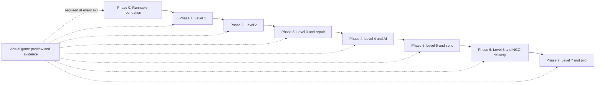

# Pocket Town Delivery Phases

These are dependency-based phases for a Godot 4 project written in GDScript, not calendar estimates. The game is English-only: UI, building signs, visual novel dialogue, choices, financial objects, captions, facilitator views, and optional narration use English. Indian settings and rupee examples remain central. Use the Compatibility renderer and layered 2D scenes for the pixelated 2.5D world. Project configuration and migration steps are in [godot_setup.md](godot_setup.md) and [godot_migration.md](godot_migration.md).

Phase 0 establishes a runnable foundation. Phases 1–7 each add one complete level to the financial concept ladder. Reuse the existing engine, renderer, and earlier concepts as the town grows. Every phase ends with a preview of the actual integrated game and recorded verification before work advances to the next phase.

## Cumulative playable milestones

| Phase | New playable content | Complete levels at exit | Supporting capability |
| --- | --- | --- | --- |
| 0 | Starter map and home introduction | Foundation only; Level 1 is not yet complete | App boot, building-to-chapter contract, local save, numerical fixtures |
| 1 | Level 1: Grocery List | 1 | Earning, spending, needs/wants, saving, ledger and weights |
| 2 | Level 2: First Account | 1–2 | Budgeting, savings account, simple interest, earned-income gate |
| 3 | Level 3: Surprise Week | 1–3 | Emergency buffer, liquidity, first complete cross-level repair |
| 4 | Level 4: Prices Move | 1–4 | Inflation, revised goals, bounded AI event personalization and API |
| 5 | Level 5: Lock or Keep Ready | 1–5 | Fixed deposits, time horizon, compounding, robust save/sync |
| 6 | Level 6: First Pay Slip | 1–6 | Gross/net income, GST examples, revenue/profit, UPI verification, NGO delivery |
| 7 | Level 7: Future Fair | 1–7 | Investment risk, diversification, suspicious offers, full-game verification and pilot |

The exact building inventory, narrative beats, and gate definitions are governed by [comprehensive_overview.md](comprehensive_overview.md) and [game_rules.md](game_rules.md). Complete level means its map, required buildings, full visual novel chapters, feasible money goal, consequences, reflection, replay, and save/resume work together. A map mockup or standalone chapter does not complete a level.

## Mandatory preview after every phase

The coordinator must run the current integrated Godot game and preview it after every phase, including Phase 0. Use F5 for the full game, not only F6 for an isolated scene. Do not mark a phase complete using only headless tests, static screenshots, unconnected mockups, or individual subagent handoffs.

1. Run the current Godot build in the editor or Windows export and verify the Android export on an available target when the phase changes mobile behavior. If browser delivery is in scope, serve and run the Godot web export over localhost or HTTPS. Record the commit, Godot version, matching export-template version, content version, target/device, and launch steps. Record an unavailable platform as unverified rather than inventing a pass.
2. Walk the newly delivered map and enter every required building. Verify each entrance opens its full visual novel presentation: interior background, staged characters, speaker and expression, bottom dialogue panel, choices, financial objects, consequences, and reflection. Check reachable entrances, depth sorting, pixel clarity, and readable English.
3. Play a safe completion route through the new level. Check ledger amounts, weight evidence, the money goal, progression gate, and next-level unlock when that next level is implemented. Show a clear completion state when it is not yet available.
4. Exercise a different decision branch, save/resume, and offline play. From Phase 3 onward, demonstrate an eligible bottleneck, the exact earlier source-choice repair, recalculation, and return to the current chapter without duplicate rewards.
5. Recheck earlier completed levels. Run the golden completion route and targeted checks for any changed shared engine, UI, content, or service behavior; cover all previous levels rather than assuming they still work.
6. Check WASD, arrow keys, normalized diagonal speed, collisions, E proximity interaction, touch controls, tap navigation, and direct building selection. Confirm movement stops during visual novel chapters, overlays, and focus loss. Inspect map and visual novel screens on supported orientations, with large text and captions; choices and financial information remain usable.
7. Capture screenshots or a short recording from the real running build. Share the preview and, when available, its playable URL or device build with the user. Record evidence in `previews/phase-XX.md`, with media in `previews/phase-XX/`: build/commit, target, levels and routes, expected versus observed results, evidence links, defects, and fixes.
8. Resolve defects that block the phase exit, rerun affected preview steps, then mark the phase complete. Continue authorized implementation after verification; the preview is a delivery gate, not an automatic request for approval.

These evidence paths are created during implementation. Do not fabricate preview results in the planning repository. Use [quality_and_learning.md](quality_and_learning.md) for detailed checks.

## Phase 0 — Runnable foundation and agreed contracts

**Build:** Create `game/project.godot` with the stable Godot 4 standard editor, GDScript, Compatibility renderer, and matching export templates. Record the exact version. Build `Main.tscn`, a `Node2D` starter town with `TileMapLayer` terrain and Y-sorted sprites, a `CharacterBody2D` player with collision, `Area2D` building entrances, and a `Camera2D`. Configure Input Map actions for WASD/arrows, E, dialogue confirm, numbered choices, Escape, journal, and touch controls. Wire the reachable home to a short English `Control` visual novel chapter. Establish nearest-filtered pixel art, responsive native UI, staged characters, and a versioned local save using `FileAccess` under `user://`. Agree on the curriculum, integer money units, ledger categories, five weights, scene schema, and event envelope. Port the numerical fixtures for the ₹100 savings gate, ₹1,000 earned-income gate, and later source-choice repair into the headless Godot test runner.

**Deliverables:** Runnable Godot project and export presets; typed GDScript interfaces and versioned JSON contracts; initial imported assets and chapter fixture; headless test runner; feasible money paths for all seven levels; synchronized governing docs. This starter chapter introduces the family and grocery errand, but does not claim to deliver full Level 1.

**Preview:** Run the Godot game with F5, move through the starter map using WASD/arrows and touch, test wall collisions and E interaction, enter home, read the staged introduction, select a sample choice, return to the map, and reopen the saved beat. Confirm movement is disabled while reading. Inspect the real pixel map and interior on the target screen and smoke-test the configured exports.

**Exit:** The preview works. Independent calculations agree on fixture balances, weight changes, and gates. Every future level has a safe feasible numerical path. Map-to-building-to-chapter and engine command/result contracts are ready for parallel work.

## Phase 1 — Complete Level 1: Grocery List

**Build:** Finish Level 1 as a Godot town scene/resource pack: home, kirana, vegetable stall, bus-stop interaction, and savings visit. Every building opens the shared `VisualNovel.tscn` chapter runner with interior, characters, dialogue, objects, and choices. Implement household versus personal money, earning, spending, groceries, needs/wants, receipts, saving, reflection, and replay in the pure GDScript engine. Add ledger commands, weight evidence, gate evaluation, and a single versioned decision/snapshot/beat save aggregate with temporary-file validation and backup recovery. Introduce authored follow-up visits and safe recovery from overspending.

**Preview:** Begin at home, compare shopping choices, complete the necessary groceries, return home, earn or preserve personal money, and save ₹100. Show one overspending branch and its recovery, the ledger, and the completion state. Recheck the Phase 0 launch and resume path.

**Exit:** Full Level 1 works offline. Saving ₹100 cannot bypass the grocery obligation, household funds cannot become personal rewards, and replay cannot pay twice. Map entrances, visual novel scenes, consequences, weight evidence, and save/resume pass the preview.

## Phase 2 — Complete Level 2: First Account

**Build:** Add the complete Level 2 map and its account-information, bank, passbook, earning-task, and budget conversations. Reuse Level 1 saving knowledge; add opening a fictional savings account, tracking deposits/withdrawals, planning a budget, simple interest over explicit simulated time, and the difference between earned income and transfers. Implement the default ₹1,000 earned-income goal and the documented alternate stipend context. Account examples remain educational and use no real personal documents.

**Preview:** Progress from the completed Level 1 save into Level 2. Visit every required building, earn ₹1,000 through the default task route, choose a deposit, inspect the budget and passbook, and observe the stated interest assumptions. Confirm transfers and interest do not count as earned income. Replay Level 1 and check that its money and decision history survive progression.

**Exit:** Both levels are complete and independently resumable. Level 2 has feasible branches, accurate interest arithmetic, no duplicate task earnings, correct income categorization, and a working gate. Earlier weights persist without prematurely testing untaught concepts.

## Phase 3 — Complete Level 3: Surprise Week and the repair loop

**Build:** Add all Level 3 emergency-expense, service/repair, household, and accessible-money chapters. Reuse earning, budgeting, and saving while introducing emergency buffers and liquidity. Implement the rule selector, severity bands, prerequisite checks, evidence threshold, authored event envelopes, and complete cross-level repair. A qualifying earlier demerit creates a contextual bottleneck; the player returns to the original choice, replaces it, recomputes the affected branch, and resumes the current chapter. Keep AI personalization disabled until these deterministic behaviors are proven.

**Preview:** Play Levels 1→2→3 with two valid histories. In the eligible history, show the bottleneck, return to the exact earlier shop decision, improve it, recalculate, and return to Surprise Week. Pay the necessary expense and retain ₹300 accessible money. Also show the route without a mandatory repair and exercise interruption/resume during repair.

**Exit:** All three levels and the repair loop work offline. The engine prevents duplicate rewards and unresolved repair loops; only taught concepts and sufficient evidence can trigger ordinary mandatory repair. The golden fixture reproduces identical arithmetic and gates. Preview all prior levels with the new replay logic.

## Phase 4 — Complete Level 4: Prices Move and bounded AI

**Build:** Add the complete Godot Level 4 market, household-budget, price-comparison, and goal-planning chapters. Introduce inflation through changed prices and purchasing power, reuse budgets, and deliver the ₹1,500 revised goal fund. Add GDScript `HTTPRequest` adapters for the optional HTTPS API, rule-selected adaptive service, bounded AI responses, English/schema validation, and authored fallback. The service implementation is separate from the Godot client; its language is not prescribed by the game brief. Keep provider credentials server-side. The engine alone owns money, weights, time, replay, and gates. Validated AI may personalize context and explanation within eligible authored constraints.

**Preview:** Play the new price-change route, compare old and revised baskets, adjust the plan, and reach ₹1,500. Show two equal-money histories receiving appropriate different eligible events. Demonstrate a valid AI response plus invalid, timed-out, non-English, and offline responses resolving to playable English authored fallbacks. Recheck Levels 1–3 and their repair paths.

**Exit:** All four levels work with or without AI/network access. Inflation explanations distinguish nominal money from purchasing power. AI cannot introduce financial advice, modify outcomes, or block progression. The actual game preview shows the fallback and deterministic results.

## Phase 5 — Complete Level 5: Lock or Keep Ready and durable progress

**Build:** Add the complete Godot savings-choice, fictional fixed-deposit, time-horizon, household-need, and comparison chapters. Introduce simple versus compound growth using explicit rates and simulated periods, and the trade-off between locking money and keeping an accessible buffer. Deliver the ₹2,500 funds-plus-buffer gate. Complete SaveManager recovery, content/save version checks, active-branch handling, and the GDScript idempotent sync queue. The optional server persists pseudonymous backup and event history in PostgreSQL. Test interrupted native writes and browser storage limitations separately; connectivity is never required for native gameplay.

**Preview:** Compare keeping money accessible with a fixed-term deposit, inspect the growth illustration and assumptions, experience a later expense, repair an eligible liquidity decision, and meet the ₹2,500 gate. Resume after interruption and exercise offline play followed by sync. Recheck Levels 1–4, especially branch recomputation and event fallback.

**Exit:** All five levels are playable offline; sync preserves the correct branch and beat without duplicating money or losing decisions. Growth is presented as a simulation assumption. Locked funds cannot masquerade as the required accessible buffer. Preview evidence includes recovery and conflict handling.

## Phase 6 — Complete Level 6: First Pay Slip and NGO delivery

**Build:** Add the complete Godot simulated-workplace, payslip, shop/stall, receipt, and payment-verification chapters. Reuse income and budgeting; add gross/net pay, illustrative deductions, GST receipt examples, revenue versus profit, and safe UPI verification. Deliver cumulative verified ₹3,500 inflows with ledger reconciliation. Add a shared Godot `Theme` for large text, captions, optional English narration through `AudioStreamPlayer`, shared-device session separation, class codes, and a facilitator `Control` scene for aggregate progress. Verify keyboard focus and target-platform accessibility support. Review age context and privacy for NGO delivery.

**Preview:** Read a payslip, reconcile net money, distinguish sales from profit, inspect a fictional tax receipt, verify a payment, and meet the ₹3,500 gate. Show a verification failure and safe retry. Run a facilitator-led English session, pause for discussion, switch student sessions safely, and inspect aggregate support needs. Recheck Levels 1–5 and accessibility in their chapters.

**Exit:** All six levels work without real financial accounts or private household data. Illustrative taxes and deductions are clearly identified; verified inflows and expenses reconcile. A facilitator can run and resume a shared-device class, and students can complete the experience offline. The preview verifies readable English and session privacy.

## Phase 7 — Complete Level 7: Future Fair and full-game verification

**Build:** Add the complete future-planning, fictional investment comparison, diversification, risk, compounding, and suspicious-offer chapters. Reuse saving, liquidity, inflation, and time horizons. Deliver the ₹5,000 protected-fund gate without counting volatile gains toward it. Include adverse and favorable simulated outcomes, concentration versus diversification, and credential/offer verification. Finish all authored repair/fallback coverage, content graph validation, meaningful engine/property tests, bot completion paths, AI safety checks, device checks, and a small learning pilot with transfer tasks.

**Preview:** Reach Future Fair through the previous levels, compare concentrated and diversified scenarios, observe both favorable and adverse assumptions, reject or recover safely from a suspicious offer, and meet the protected-fund gate. Demonstrate an eligible earlier-level repair and return to the final chapter. Run the full seven-level golden route and regression checks, including offline/fallback, save/resume, large text, and facilitator delivery.

**Exit:** Every level, building chapter, money path, gate, repair, and authored fallback is integrated. No double rewards or unresolved progression loops remain. Learners can explain consequences and apply lessons to transfer tasks; record the pilot findings without asserting improvement unsupported by evidence. Resolve release-blocking defects and document any remaining issues. A real full-game preview and its evidence complete the phase.

## Hackathon demonstration cut

The target is the complete seven-level game. If delivery time is constrained, report exactly which phases and levels pass their exits. A compelling smaller demonstration is the completed Phase 3 path: ₹100 saving → ₹1,000 earned income → emergency bottleneck → earlier choice repair → deterministic return. Later phase previews extend that same running game. A prerecorded fallback must record the real build; unfinished content maps are labeled planned content.

## Parallel implementation with subagents

Use a parent coordinator to assign independent work to subagents after agreeing on interfaces. Parallel work shortens independent implementation and review tasks; phase dependencies and integrated preview gates determine advancement. The coordinator owns cross-document decisions, integrates handoffs, runs the actual game, and shares each phase preview.

### Ownership and boundaries

Each assignment names exact files or directories. One agent owns a file at a time; shared schemas, manifests, and app entry points have one designated owner. In a shared checkout, use disjoint paths. Separate branches are integrated sequentially. Agents request interface changes before touching another workstream's files.

| Workstream | Assigned ownership | Required handoff |
| --- | --- | --- |
| Coordinator/contracts | Shared types, schema versions, manifests, app wiring, integration | Contract version, fixtures, assignment list, running phase build and preview evidence |
| Financial engine | `game/scripts/engine/` and assigned `game/tests/` fixtures | Deterministic GDScript results, feasible goals, no duplicate rewards |
| Town renderer | Assigned `game/scenes/world/`, `game/scenes/player/`, `game/scenes/buildings/`, and matching scripts | 2.5D projection, collisions, Input Map movement, anchors, Y-sort, reachable entrances and device evidence |
| Visual novel renderer | Assigned `game/scenes/visual_novel/`, matching scripts, and chapter UI resources | Staged interiors, dialogue, expressions, choices, objects, consequences and resume |
| Art/authored content | Separate level packs in `game/content/` and assigned `game/assets/` families | Original imported assets, English text keys, stable IDs, prerequisites, repairs and validated chapters |
| API/adaptive service | Assigned `services/` modules and `game/scripts/network/` adapters | JSON-contract-compatible service, bounded English events, fallbacks, migrations and sync evidence |
| QA/delivery | Separate `game/tests/` suites, reports, export checks, or facilitator `Control` modules | Reproducible findings and checks against [quality_and_learning.md](quality_and_learning.md) |

Paths follow [architecture.md](architecture.md). During documentation work, assign exact Markdown files with the same ownership rule. Assign `project.godot`, `export_presets.cfg`, shared `.tscn` scenes, autoload registration, resource manifests, and contract files to one owner each. Agents must not save the same scene in different editor instances. Commit source `.uid` files with scripts; keep the generated `.godot/` cache out of Git.

### Interface agreement in Phase 0

1. Version scene/choice IDs, concept prerequisites, integer money units, ledger categories, weight evidence, money goals, gate results, and replay semantics.
2. Agree on engine command/result and snapshot contracts, including fixtures for both early gates and downstream repair.
3. Fix the rectangular ground grid, angled overhead projection, asset anchors, footprints, entrance IDs, tap areas, layers, and building-to-chapter links using [design.md](design.md).
4. Fix chapter backgrounds, staged characters, expressions, dialogue beats, financial objects, choices, consequences, history, and saved beat position. Every building opens the visual novel presentation.
5. Agree on event envelopes, English text keys, approved fallback IDs, save/sync messages, idempotency, and version compatibility. AI cannot change numerical rules.

Provide versioned fixtures and stub adapters. The coordinator updates shared contracts and fixtures before assigning dependent interface changes.

### Phase-specific parallel assignments

| Phase | Independent assignments | Integration and preview dependency |
| --- | --- | --- |
| 0 | Engine fixtures; curriculum feasibility; starter map/art; home chapter UI | Agree contracts, wire the starter app, then preview real map→home→resume |
| 1 | Level 1 chapters/art; engine ledger and gates; map entrances; focused QA | Integrate full grocery-to-₹100 route and preview Level 1 |
| 2 | Level 2 account/task content; account/interest operations; map assets; income-gate checks | Integrate full Level 2, preserve Level 1 history, preview both |
| 3 | Level 3 emergency content; deterministic repair/selector; return UI; replay tests | Prove the complete Level 1→2→3 repair loop and preview all three |
| 4 | Level 4 inflation content; API; bounded AI adapter; invalid/offline response checks | Integrate authored fallback first, then AI; preview Level 4 and prior levels |
| 5 | Level 5 deposit/compounding content; persistence/sync; recovery checks | Integrate correct active-branch sync and preview all five levels |
| 6 | Level 6 payslip/payment content; facilitator modules; English accessibility; privacy QA | Integrate classroom delivery and preview all six levels plus session flow |
| 7 | Level 7 risk/fraud content; separate full-game test suites; pilot preparation | Integrate fixes, preview the full game, record pilot and final evidence |

### Assignment and handoff checklist

An assignment states its goal, owned paths, contract version, dependencies, input fixtures, expected artifact, and acceptance check. A handoff reports changed paths, behavior, test evidence, unresolved issues, and required follow-up. Waiting on an interface is a recorded dependency; other ready tasks can continue.

Review handoffs against the governing docs, integrate one change at a time, and run focused validation plus the current phase's integrated checks. Inspect actual map and chapter presentation after visual changes; rerun arithmetic, idempotency, and repair checks after engine/service changes. Return failures to the relevant owner and retain a runnable build after integration. Independent agents declaring completion does not satisfy the phase preview gate.

## Workstream dependencies

