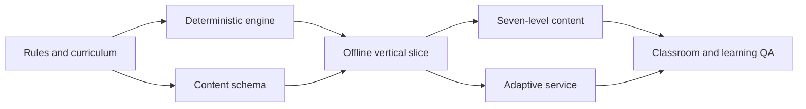

# Pocket Town Delivery Phases

These are dependency-based phases, not calendar estimates. Do not expand content production until the cross-level repair loop works on a device. Each phase ends with a reviewable artifact and an explicit exit test.

## Phase 0 — Lock the playable contract

**Build:** Agree on the seven-level curriculum, ledger categories, money objectives, five weight meanings, scene schema, and event safety envelope. Create a small fixture for the ₹100 Level 1 path and ₹1,000 Level 2 default task path.

**Deliverables:** Approved versions of [product_requirements.md](product_requirements.md), [game_rules.md](game_rules.md), [content_authoring.md](content_authoring.md), JSON Schemas, and a choice sequence fixture.

**Exit:** Two people can independently calculate the fixture's balances, weight changes, and gate result and get the same answer. Every level goal has at least one safe feasible path in a spreadsheet or engine simulation.

## Phase 1 — Offline vertical slice

**Build:** Expo navigation, one small pixelated 2.5D Level 1 map, layered home and kirana assets, avatar movement, depth sorting, walkable routes and building hit areas. Build a complete visual novel chapter runner with interior backgrounds, expressive character portraits, speaker dialogue, branching choices, visual consequences, financial objects, reflection, and follow-up visits. Add the ledger, local save, deterministic engine, and one authored repair chapter. Add Level 2 entry and Level 3 surprise event so the earlier Level 1 choice can matter later. Use [design.md](design.md) to lock the pixel perspective, staged interiors, and dialogue panel style before expanding production art.

**Demo path:** Save ₹100 after groceries → earn ₹1,000 from default simulated tasks → enter Level 3 → receive an overspending bottleneck → return to the exact kirana choice → replace it → recompute and resume Level 3.

**Exit:** The path works end to end offline on a midrange Android device; map depth and building taps are correct; every required entrance is reachable; labels remain readable; the numbers are reproducible; replay awards no duplicate money; the player can always complete the repair.

## Phase 2 — Complete the content ladder

**Build:** Finish the seven pixelated 2.5D maps, building assets, authored routes, and choices using versioned content packs. Reuse a consistent sprite scale, perspective, ground anchors, and occlusion policy. Add simple interest, recurring budgets, emergency buffer, inflation, fixed deposits, future payslip and GST examples, UPI verification, investment scenarios, diversification, compounding, and suspicious offer scenes. Produce an authored fallback for each eligible bottleneck.

**Exit:** Every level has its required map, buildings, money path, consequence cards, later transfer scene, and at least one replay branch. No scene asks about a concept before its prerequisite. Bot paths can finish all levels safely.

## Phase 3 — Adaptive events and service

**Build:** Rule selector, severity bands, event envelope, bounded AI adapter, schema/text validator, authored fallback, Node.js API, PostgreSQL save and event log, idempotent sync. Keep the model outside all money and gate calculations.

**Exit:** Distinct spending, cash concentration, and risk histories at the same rupee gate produce appropriate distinct events. Invalid, unsafe, timed-out, or offline AI calls produce a valid authored event without blocking play.

## Phase 4 — Classroom readiness

**Build:** English polish, Telugu and Urdu content paths, Urdu right-to-left checks, subtitles, optional audio, large text, shared-device session handling, class codes, and a minimal facilitator view with aggregate progress. Review student privacy and age context with an NGO partner.

**Exit:** A facilitator can start a class, pause for a discussion prompt, resume saved sessions, and read aggregate concept support needs. Students can complete the app without network access or private financial data.

## Phase 5 — Verification and pilot

**Build:** Engine unit and property tests, content graph validation, bot simulations, AI safety tests, offline recovery tests, device usability tests, and a small learning pilot with later transfer scenes. Use [quality_and_learning.md](quality_and_learning.md) as the test plan.

**Exit:** All money targets and repairs are reachable; no double rewards or unresolved loops remain; learners understand why a bottleneck occurred; transfer improves after replay in the pilot. Document unresolved issues and their severity before release.

## Hackathon demonstration cut

If time is limited, demonstrate Phase 1 completely and show the remaining levels as validated content maps rather than claiming they are implemented. The key proof is the same-money/different-history repair loop and exact branch recalculation. A prerecorded fallback should be a recording of the real build, not a separate mock interaction.

## Parallel implementation with subagents

Use a parent coordinator to assign independent work to subagents after agreeing on the interfaces. Parallel work can shorten independent implementation and review tasks; phase dependencies and exit tests still determine when the project can advance. The coordinator keeps the playable milestone in view, resolves design decisions, integrates completed work, and verifies the complete game path.

### Ownership and task boundaries

Each task names its exact files or directories before work begins. One agent owns a file at a time. The coordinator maintains an active assignment list and assigns shared files, schemas, dependency manifests, and application entry points to one owner. Agents report a requested interface change before editing another workstream's files. In a shared checkout, work in disjoint files; with separate branches or checkouts, the coordinator integrates each reviewed change sequentially.

| Workstream | Assigned ownership | Required handoff |
| --- | --- | --- |
| Coordinator and contracts | Shared types, schema versions, dependency manifest, app wiring, cross-document decisions, integration. | Agreed contract version, fixtures, assignment list, and integrated demo build. |
| Financial engine | `packages/engine/` ledger, fictional time, weights, gates, replay, and engine tests. | Pure engine interface, fixture results, and evidence of deterministic replay without duplicate rewards. |
| Town renderer | Map rendering and navigation modules in `apps/mobile/`, excluding chapter UI and shared app wiring. | Angled overhead pixel map with anchors, draw order, reachable entrances, building selection, and device evidence. |
| Visual novel renderer | Dedicated chapter UI modules in `apps/mobile/`, excluding map rendering and financial calculations. | Building entrance opens a staged interior, speaker dialogue, expressions, objects, choices, consequences, history, and resume behavior. |
| Art and authored content | Explicitly assigned asset bundles and level-specific content directories. Assign separate levels or asset families to separate agents. | Assets and scenes satisfying [design.md](design.md), stable IDs, localization keys, prerequisite metadata, authored repairs, and validation results. |
| API and adaptive service | `apps/api/` endpoints, persistence adapters, sync, bounded AI adapter, and service tests. | Contract-compatible service, migration notes, validated fallback behavior, and idempotency evidence. |
| QA and delivery | Assigned integration tests, bot fixtures, test reports, localization review, or facilitator modules. | Reproducible failures, checks against [quality_and_learning.md](quality_and_learning.md), and reviewed completion evidence. Production fixes return to the owning workstream. |

Repository paths follow [architecture.md](architecture.md). Before the implementation repository exists, assign exact Markdown files, content fixtures, or asset deliverables using the same ownership rule. Art and content may be separate tasks once their metadata contract is agreed; they must not edit the same asset manifest simultaneously.

### Interface agreement before parallel build

Complete these agreements in Phase 0 and record their version. A freeze means changes require a coordinated update, not that the design can never improve.

1. Fix scene and choice IDs, concept prerequisites, ledger categories, money units, weight evidence, money goals, gate results, and replay semantics.
2. Agree on the engine command/result and snapshot interfaces. Include a fixture covering the ₹100 savings gate, ₹1,000 earned-income gate, later bottleneck, source-choice repair, and downstream recomputation.
3. Fix map projection, asset anchors, footprints, entrance IDs, tap areas, layer metadata, and the building-to-chapter link. Follow the rectangular ground grid and angled overhead view in [design.md](design.md).
4. Fix the chapter format for backgrounds, staged characters, expressions, dialogue beats, financial objects, choices, consequences, follow-up visits, and saved beat position. Every building opens this visual novel presentation.
5. Agree on event envelopes, approved fallback IDs, save/sync messages, idempotency keys, and version compatibility. The AI adapter cannot change balances, weights, or gate calculations.

Provide versioned fixtures and stub adapters so each workstream can develop against the agreed interface. The coordinator reviews an interface change with the affected owners, updates shared contracts and fixtures first, then assigns the dependent changes. Do not let different agents independently redefine the same financial rule or schema.

### Phase-specific assignments

| Phase | Tasks that can proceed independently | Integration dependency |
| --- | --- | --- |
| 0: Playable contract | Curriculum/content agent checks prerequisites and feasible money paths; engine agent calculates the fixture; design agent checks one home/kirana exterior and interior; QA agent independently checks the numerical path. | Coordinator reconciles the results and freezes shared schemas, interfaces, and asset metadata before implementation branches depend on them. |
| 1: Offline vertical slice | Engine agent implements choices, gates, and repair; town agent builds navigation and depth; visual novel agent builds the chapter runner; art/content agents prepare the home, kirana, and later repair fixtures; QA agent prepares offline/resume checks. | Coordinator wires building entrances to chapters and chapters to the engine, then runs the complete Level 1 → Level 2 → Level 3 repair path on device. Expand art only after reviewing this slice. |
| 2: Content ladder | Content agents own separate levels; art agents own separate asset families or building interiors; engine owner adds agreed financial operations; QA validates prerequisite graphs and safe completion paths as packs arrive. | Each pack must use the approved schema, asset IDs, arithmetic, and visual style. Cross-level transfer and repair scenes receive joint review before the coordinator activates the pack. |
| 3: Adaptive service | API agent builds save/sync endpoints; adaptive-event agent builds rule-selected envelopes and bounded personalization in separately assigned modules; client owner adds sync adapters; QA exercises invalid responses and offline fallbacks. | Freeze request/response contracts first. Integrate authored fallback behavior before enabling personalization, then verify that all numerical outcomes remain in the engine. |
| 4: Classroom readiness | Language owners review distinct translation files; visual novel owner checks expansion and script layout; facilitator agent builds aggregate views; delivery/QA owner tests shared devices and classroom flow. | Coordinator integrates approved translations and accessibility settings, then validates complete chapters and class sessions in each language. |
| 5: Verification and pilot | QA agents divide engine/property, content/bot, service/fallback, device/accessibility, and learning-pilot checks into separate suites or reports. Module owners fix assigned findings. | Coordinator reruns affected checks and the complete demonstration path after integration. Phase exit requires observed evidence, not separate agents declaring their modules complete. |

### Assignment and handoff checklist

An assignment states the goal, owned paths, contract version, dependencies, input fixtures, expected artifact, and acceptance check. It also states which shared files need a coordinator change. An agent completes its independent work, runs the appropriate checks, and returns changed paths, behavior implemented, test evidence, unresolved issues, and any required follow-up. Waiting on an interface is recorded as a dependency; the coordinator can assign other ready work while resolving it.

Review the handoff against the governing documents, then integrate one change at a time. Resolve conflicts with the relevant owner and update any affected fixtures. Run schema/content validation and focused checks for the change, followed by the integrated checks needed for the current phase exit. For map or chapter changes, inspect the actual device presentation, including entrance selection, pixel depth, dialogue readability, financial objects, and replay/resume. For money or service changes, rerun deterministic arithmetic, idempotency, and repair tests.

Keep a working demo build after each integration. If a subtask fails its handoff check, return the specific issue to its owner and continue other independent work. The coordinator reports completed artifacts and remaining dependencies without treating parallel activity as evidence that the game is finished.

## Workstream dependencies

