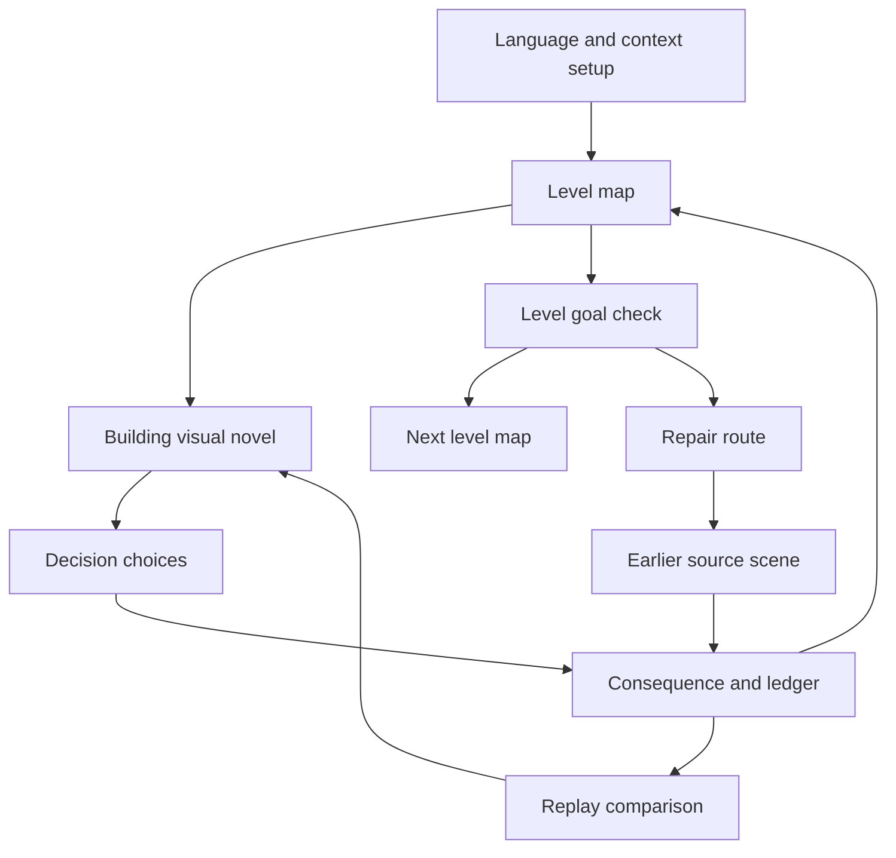

# Pocket Town Screen and Interaction Flow

## Navigation map

## Main screens

Visual styling follows [design.md](design.md): a pixelated town in an angled overhead view, and a dedicated building scene with staged pixel characters, an interior background, and a prominent bottom dialogue panel. Financial text and choices render at readable native interface size.

| Screen | Required information and action |
| --- | --- |
| Setup | Language, optional fictional money context, goal, audio/text preferences, anonymous class code if used. Explain that no real financial data is needed. |
| Map | pixelated 2.5D buildings and streets, animated avatar, current goal, accessible money, active story task, completed scene markers, and a distinct repair pin when applicable. Movement is exploratory and never charges money. |
| Visual novel | Dedicated chapter screen opened by every building: illustrated location background, expressive character portraits, speaker name, dialogue box, optional audio/subtitles, branching choices, financial scene objects, consequence beats and back-to-map after a story lead. |
| Decision preview | Show known price, time, access, and conditions. Do not reveal an unknown future surprise, but do not hide a stated fee or term. |
| Consequence | Show the chosen action, immediate story result, exact ledger delta, any later consequence hint, and a plain-language explanation. Keep private demerit numbers internal. |
| Ledger | Separate earned/task money, allocated expense money, savings, deposits, interest, and fictional investment value. Make source and time visible. |
| Gate | Show whether the money goal is met, what needs attention, and whether the player advances, advances with a scheduled later event, or repairs now. Avoid telling a student they are a “bad saver.” |
| Repair | Explain the connection to an earlier decision, highlight its building, offer a hint, and show the paused return point. |
| Replay comparison | Show old and new branches with the same scenario seed, monetary effects, access, and tradeoffs. State that replay does not award a second payment. |
| Money Wall finale | Summarize concepts used, a revised choice, a suspicious offer verified, and the protected goal. Do not rank players by wealth. |

## Interaction rules

The visual novel is the primary teaching experience. All building conversations, purchase decisions, bank explanations, unexpected expenses, and repair encounters use the chapter flow in [visual_novel_design.md](visual_novel_design.md). A receipt, chart, or calculator supports the narrative decision and returns to its dialogue and consequence.

- One tap on a building opens its current relevant scene; do not require precise collision movement on a small screen. A brief optional avatar walk to its entrance can support the transition. A ground tap routes the avatar along walkable streets around building footprints.
- Use a fixed angled overhead view with bounded camera pan and optional zoom. Keep entrance markers and building labels readable above sprites; split or fade foreground roofs and props when they obscure the player. A visible-target tap must not select a building behind it.
- Buildings can be visited in different orders, but a prerequisite dialogue branch becomes available only after its earlier concept is taught. If locked, show a helpful lead to the relevant building.
- Returning to a building opens its state-aware follow-up chapter. Preserve dialogue position, selected choice, and displayed consequence when a session is interrupted.
- A consequence card must be readable before auto-advancing. A player can reopen it from the ledger or scene history.
- A repair pin points to the exact source building and scene, not merely the old level's entrance. After replacement, show what changed and resume at the paused checkpoint.
- In a no-network state, show a small offline indicator; do not interrupt the story. Sync status belongs in settings, not every decision.
- Hints explain the decision frame and options, not a command to pick the largest rupee balance.

## Accessibility review

Text can enlarge without clipping choices. Every map icon has a label and screen-reader name. Color is not the only sign of a completed, open, or repair building. Screen reader focus follows speaker, dialogue, options, then consequence. Urdu right-to-left review must cover map labels, choice order, and mixed number/currency runs. See [localization_and_delivery.md](localization_and_delivery.md).

## Vertical-slice screen acceptance

The first demo must let a learner complete the Level 1 grocery trip, inspect the ₹100 savings result, enter Level 2, reach the ₹1,000 default task earnings goal, encounter a Level 3 overspending event, follow a repair pin to the kirana decision, and return to Level 3 with recomputed values. No hidden developer controls should be needed during that path.
